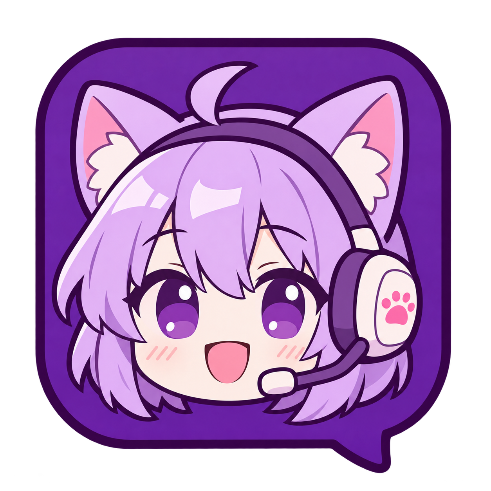
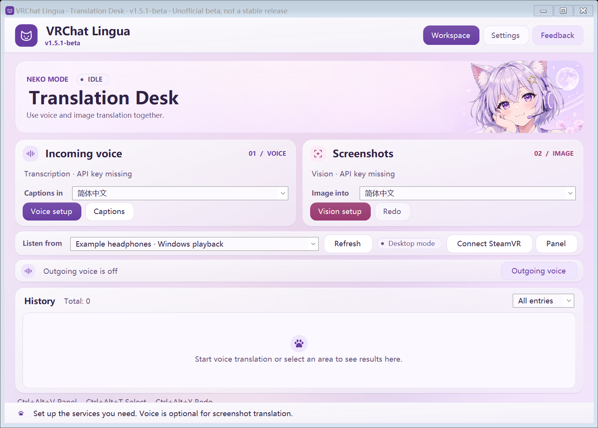
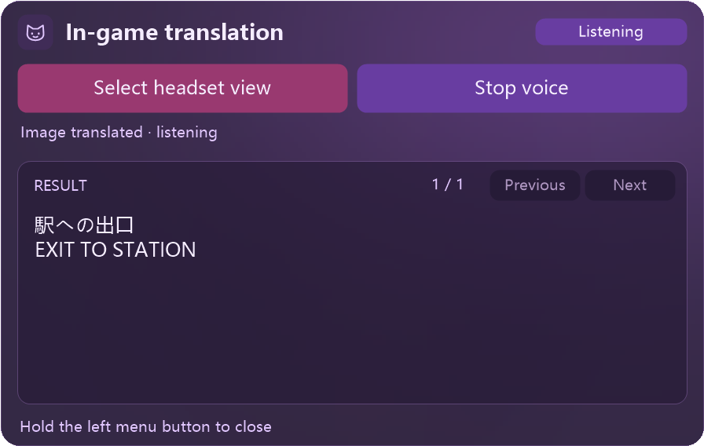
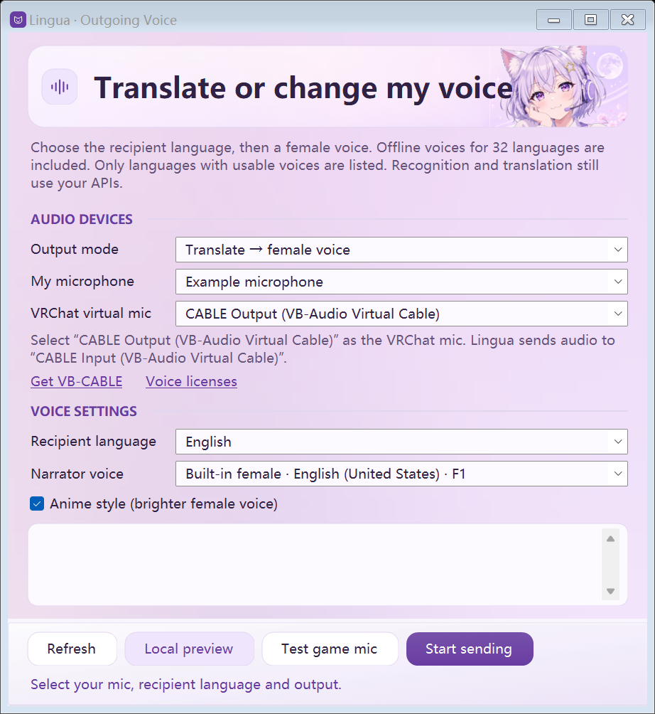

  

# VRChat Lingua

**Listen, read, and speak across languages in VRChat.**

> **v1.5.1 Beta** · Unofficial test build, not a stable release.

A standalone Windows companion for subtitle translation, translating text in screenshots, and speaking translated audio back into the game. Its desktop and SteamVR views can show translations while you keep playing.

[Download v1.5.1 Beta](https://github.com/LinguaNeko/VRChat-Lingua/releases/tag/v1.5.1) · [Quick start](#quick-start) · [User guide](docs/USAGE.md) · [简体中文 / 日本語 / 한국어 / English (US)](docs/LANGUAGES.md)

*Example devices and settings are shown. No API key is included.*

## Features

| Feature | What it does |
| --- | --- |
| **Bilingual captions** | Transcribes audio from a selected Windows playback device and shows the original and translation in a separate overlay. |
| **Screenshot translation** | Translates a selected area containing signs, menus, or readable handwriting with an image-capable model. |
| **SteamVR overlay** | Lets you select a region of the current headset view with a controller. No VRChat camera, desktop mirror capture, plugin, or game injection is required for headset capture. |
| **Outgoing voice** | Translates speech from your microphone and reads the result in a synthesized female voice. Includes **159 offline female presets across 32 languages**, plus a separate voice-change mode that does not translate. |
| **Separate AI providers** | Configure transcription, text translation, and vision independently. The app includes presets for OpenAI, DeepSeek, Grok, Gemini, Qwen, and others, plus OpenAI-compatible custom endpoints. Model availability depends on your provider and account. |

Incoming voice captions and screenshot translation can run together. The interface language, caption target, screenshot target, and recipient language are separate settings.

## Download

Requires **Windows 10 or 11 (64-bit)** and **.NET Framework 4.8**. In [v1.5.1 Beta → Assets](https://github.com/LinguaNeko/VRChat-Lingua/releases/tag/v1.5.1), choose the **Windows x64 portable EXE** and run it directly. No application installation, separate DLL, or voice pack is needed.

SteamVR is optional for PC VR. A paired [VB-CABLE](https://vb-audio.com/Cable/) device is needed only when routing outgoing audio into VRChat. SteamVR and the virtual cable are downloaded separately. Local voice previews work without VB-CABLE.

## Quick start

1. **Configure your services.** Open **Settings**. Use **Transcription** and **Text translation** for spoken translation, or configure **Vision** alone if you only want screenshots. Enter your own API key where required, choose a compatible model, and select **Test API**.
2. **Translate what you hear or see.** In **Listen from**, choose the headphones or speakers actually playing VRChat. Set **Captions in** and select **Start voice**. For desktop screenshots, set **Image into** and press **Ctrl + Alt + T** to draw a region.
3. **In VR:** Run SteamVR and PC VRChat, select **Connect SteamVR**, and press **Ctrl + Alt + V** or use the bound controller menu action. Point at the text, select **Select headset view**, and drag a box in the frozen preview with the trigger.

*Illustrative SteamVR overlay rendering. Headset capture uses the current left-eye view, not a movable world camera.*

### Let others hear your translation

In **Outgoing voice**, select your physical microphone, the recipient language, and a narrator. Try **Local preview** first. For in-game playback, set the VRChat microphone to the paired recording endpoint (**CABLE Output**); Lingua plays into **CABLE Input** automatically. Check the in-game microphone meter with **Test game mic**, then select **Start sending**.

## Important limits

- Captions are translated in phrases, not word by word. Voice capture uses the selected device's mix and cannot isolate one player from music or overlapping speech.
- Only the chosen image region is sent to the configured vision service. Speech and text services may receive selected audio segments or transcripts and may charge for requests. Built-in speech synthesis and local previews are offline.
- This is not an official VRChat product. SteamVR capture requires a Windows PC and does not run directly on a standalone Quest.

See the [full user guide](docs/USAGE.md), [v1.5.1 Beta notes](docs/RELEASE-v1.5.1.md), and [third-party components](docs/THIRD-PARTY.md). When reporting a problem, include the version, feature, and exact error; **never share your API key**.

This repository distributes documentation and Windows binaries, not application source code.
