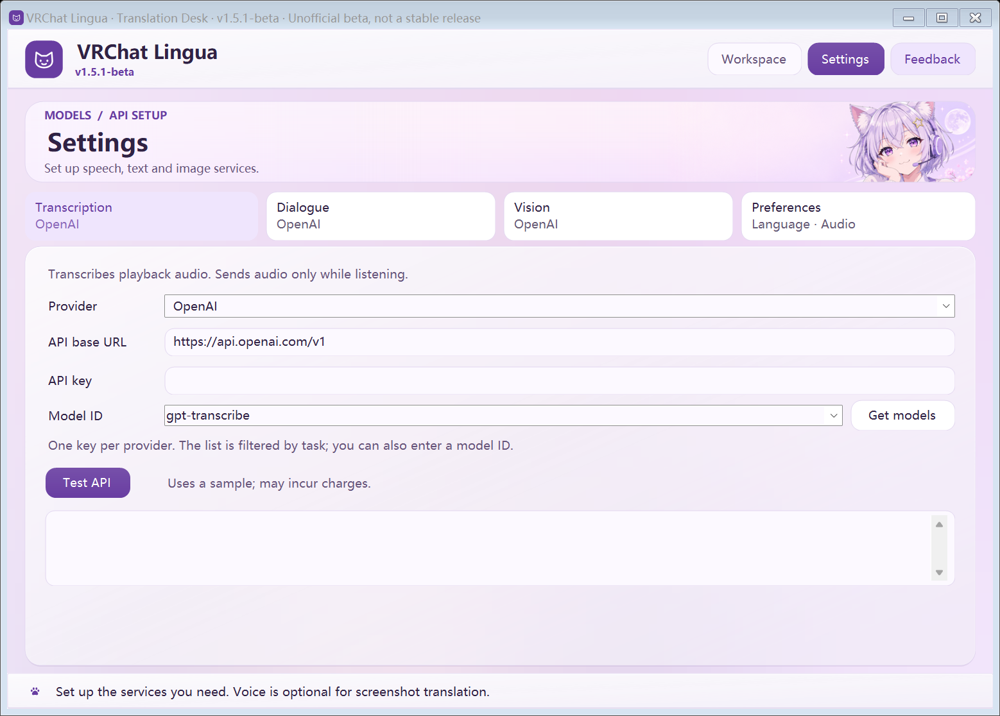
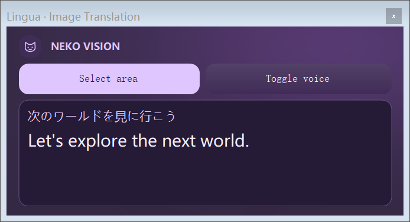

# VRChat Lingua user guide

[Project home](../README.md) · [Four-language comparison](LANGUAGES.md) · [Download v1.5.1 Beta](https://github.com/LinguaNeko/VRChat-Lingua/releases/tag/v1.5.1)

> **Unofficial Beta.** Download the portable EXE from the release assets and run it directly; there is no application installation step.

## Configure the services you need



- **Transcription** turns audio segments into text. **Text translation** translates those transcripts. **Vision** reads and translates the text in an image.
- Pick a provider for each task, enter its API key when required, and select the model ID. Different providers, regions, and custom slots do not share credentials.
- **Fetch models** lists compatible candidates from the provider when its model endpoint is available. If a custom or private model does not appear, enter its ID manually after checking the capability and your account access.
- **Test API** sends one built-in sample, not live microphone audio or a screenshot. The provider may charge for the test. OpenAI-compatible custom transcription requires a file upload endpoint; vision needs a model that accepts pictures and returns text.
- To keep a key between restarts, enable encrypted storage in **Settings → Preferences**. The saved key is protected by Windows DPAPI for the current Windows user. Do not put credentials in URLs or screenshots.

Set **Interface language** in **Preferences** to change labels without changing any translation target.

## Incoming voice and desktop capture

1. Choose the device playing VRChat in **Listen from**. This is usually your headset or speakers, not a microphone.
2. Select **Captions in**, then **Start voice**. Use **Captions** to open the subtitle window. Short pauses give the translator time to turn speech into phrases.
3. Set **Image into** separately for screenshots. Keep the relevant text visible, select a region, and release the mouse to submit it. Press Esc or right-click to cancel.

| Shortcut | Result |
| --- | --- |
| **Ctrl + Alt + V** | Toggle the desktop translation panel, or the headset panel when SteamVR is connected |
| **Ctrl + Alt + T** | Freeze the desktop so you can drag a region |
| **Ctrl + Alt + Y** | Re-read the last screen rectangle at its current pixels |
| **Esc / right-click** | Cancel desktop selection without sending an image |



## SteamVR controller capture

1. Start SteamVR and enter PC VRChat. Select **Connect SteamVR** in the Workspace.
2. Close the SteamVR dashboard. Open the overlay with **Ctrl + Alt + V**, or hold the bound left-hand menu action.
3. Look at the target, point the right-hand controller at **Select headset view**, and press the trigger.
4. Drag diagonally on the frozen image with the trigger and release inside the image. Retake it if the subject moved, or go back to cancel.

| Default binding profile | Toggle overlay | Select / drag |
| --- | --- | --- |
| Quest / Oculus Touch through SteamVR | Left Y | Right trigger |
| Valve Index | Left B | Right trigger |
| Vive Wand | Left grip | Right trigger |

Bindings depend on the SteamVR controller profile. If there is no pointer, check the **Menu**, **Select**, and **Aim** actions in SteamVR. Hand pinching is experimental and needs compatible tracking data. The capture source is the current composited left-eye frame. It is not the VRChat built-in camera, a desktop or game-window shot, or a free-camera viewpoint.

## Outgoing translated voice

1. Open **Outgoing voice** and choose **Translate → female voice**. Select a physical microphone, **Recipient language**, and **Narrator voice**.
2. Select **Local preview** to listen on your normal Windows speakers or headset. It does not need the microphone, VB-CABLE, or any API. The first use of a non-Mandarin built-in voice opens its license dialog.
3. To route speech to VRChat, install [VB-CABLE](https://vb-audio.com/Cable/) separately and refresh the device list. Select the paired virtual mic in Lingua, then select its recording endpoint in VRChat.
4. Select **Test game mic** and verify VRChat's microphone meter. Other players can hear the test if your game mic is open. Select **Start sending** and pause briefly between phrases.

```text
Physical microphone → transcription → translation → local female voice
                    → CABLE Input (playback) → CABLE Output (recording) → VRChat mic
```

Keep your actual headphones or speakers as the game's output device. If you only want to change your voice without translation, select **Live voice change · no translation**. It adjusts pitch and resonance locally without a cloud service. The app hides language entries with no usable narrator and does not uninstall Windows speech packs.

## Troubleshooting

| Symptom | Check first |
| --- | --- |
| No caption activity | Verify that **Listen from** is where VRChat is actually playing. After unplugging a device, stop capture, refresh, and select it again. |
| Text works but images fail | Test **Vision** separately. Confirm that the model accepts images and crop to the readable text. |
| Voice preview is unavailable | Use a physical default output, not a virtual cable. If incoming translation is capturing that same device, stop it before previewing. |
| Local preview works but VRChat is silent | Check the paired cable, the recording endpoint (**CABLE Output**) in VRChat, and in-game mute or push-to-talk. |
| Blank headset preview | Confirm that VRChat is the active SteamVR game, that the headset is rendering, and that the dashboard is closed. |
| API failures | 401/403: key or permissions. 404: address or model ID. 429: quota or rate limit. |

## Privacy and costs

The app runs capture only for started tasks and does not continuously upload the desktop. Audio segments, transcripts, and selected image crops are sent to the services you configure when needed. Their terms and retention policies apply; inform participants before capturing their voices. Built-in female speech is generated locally. API calls may cost money, including self-tests. Do not post keys, recordings, private screenshots, or conversations when reporting an issue.
